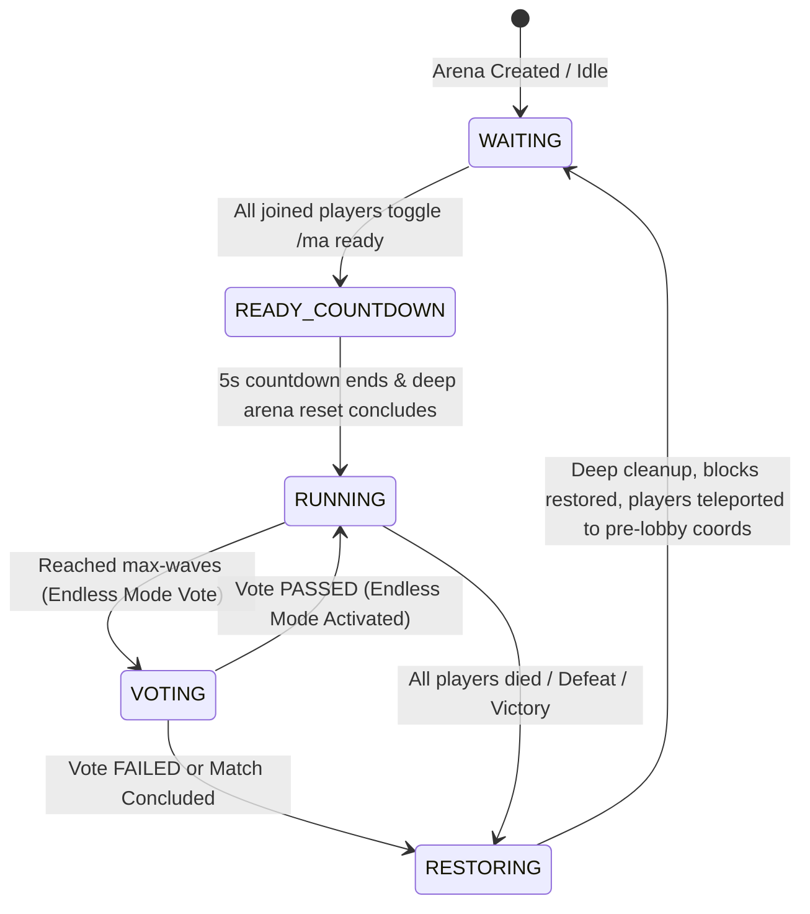

# 🏛️ MobArenav2 — Master Architectural Specification & Developer Handover Guide

> **Target Audience:** Core Developers, Maintainers, and Autonomous AI Agents (Claude, DeepSeek, Cursor, Windsurf).  
> **Plugin Version:** `v8.4.5`  
> **Target Platform:** Paper / Purpur 1.21.4 (Java 21 / 25)  
> **Language Standards:** Java 21+ Virtual Threads & Modern Records, Bukkit/Adventure API, strictly English in-game text and documentation.

---

## 1. Architectural Philosophy & Design Principles

MobArenav2 is engineered around five core tenets:
1. **Decoupled Event-Driven Flow:** Systems (combat pipelines, upgrade registries, boss state machines, economy hooks) communicate through modular interfaces and registries rather than monolithic event listeners.
2. **100% Data-Driven Combat Mechanics (Zero Hardcode):** All damage scalings, proc chances, cleave radii, knockback resistances, milestone perks, and boss skill cooldowns are read dynamically from YAML configurations via `UpgradeData` and Boss Settings. Code contains zero hardcoded combat arithmetic.
3. **Main Thread Preservation:** Zero heavy disk I/O or database queries on the Minecraft main server thread. SQLite runs in **WAL Mode**; arena YAML summaries serialize asynchronously via `CompletableFuture.runAsync()`.
4. **Anti-Leak & Idempotent State Restoration:** When an arena match resets or concludes, every spawned mob, leftover projectile (arrows, tridents), supply chest, dropped item, boss bar, and scoreboard team is deterministically purged. Players' pre-lobby world coordinates are persisted on disk (`<uuid>.yml`) to guarantee exact return upon match exit or death.
5. **Vanilla Client Synchronization:** Features like **Extended Reach** leverage native Paper 1.21.4 attributes (`generic.entity_interaction_range`) rather than hacky raycasts, ensuring 100% client visual sync and zero anticheat reach flags.

---

## 2. Codebase Organization & Package Layout

```
vn.meowchan12.mobarenav2/
├── MobArenav2.java                 # Main plugin entrypoint, manager initializations, event registrations
├── arena/                          # Arena lifecycle, game loop, restore, and GUI interfaces
│   ├── Arena.java                  # Central arena state machine, player tracking, duration analytics
│   ├── ArenaBoss.java              # Live boss entity manager (BossBar, skill queue, dynamic AI settings)
│   ├── ArenaMemoryManager.java     # Centralized entity & leftover projectile culling engine
│   ├── ArenaPlayerProfile.java     # Per-player in-match session data (kills, DPS, overcap stats, upgrades)
│   ├── ArenaRestorer.java          # Pre-match & post-match deep world cleanup and block restoration
│   ├── ClassGUI.java               # Interactive class selection inventory
│   ├── FusionDraftGUI.java         # Non-mandatory Ultimate Fusion draft selection GUI
│   ├── MatchDetailGUI.java         # Post-match record & player performance inspector GUI
│   ├── MobAttributeParser.java     # Custom YAML mob attribute and equipment parser
│   ├── MobFactory.java             # Entity instantiator, boss tagging (arena_boss_id, ma_boss_id, MA_BOSS)
│   ├── UltimatePreviewGUI.java     # Almanac GUI for previewing Ultimate fusion recipes
│   ├── UpgradeGUI.java             # Dual-tier directory, in-match draft rolls, pity system, ascendance pool
│   └── VoteGUI.java                # Endless mode voting interface
├── boss/                           # Advanced boss mechanics & modular skills
│   ├── BossCounterMeta.java        # Anti-Elytra grounding, totem shatter bypass, true damage logic
│   ├── BossPhaseManager.java       # Multi-phase health thresholds and phase skill transitions
│   ├── BossRewardManager.java      # Thread-safe damage tracking, anti-leech thresholds, tiered loot crates
│   ├── CrushingBlowMechanic.java   # Shield break windup, particle telegraphing, and damage gating
│   └── skill/                      # 23+ Modular Boss Skill implementations (BloodFrenzy, ShieldBreak, etc.)
├── command/                        # Command dispatchers and subcommands
│   ├── ArenaCommand.java           # Master command router with permission-aware tab completion
│   ├── SubCommand.java             # Autonomous subcommand interface
│   └── sub/                        # Subcommand implementations:
│       ├── AdminArenaCommand.java  # Admin arena setup, boundary markers, wave skipping, testing
│       ├── ClassCommand.java       # Class selection GUI and direct class switching
│       ├── ForceEndCommand.java    # Administrative immediate arena termination
│       ├── ForceStartCommand.java  # Administrative countdown bypass and immediate match start
│       ├── FuseCommand.java        # Ultimate Fusion draft GUI dispatcher
│       ├── HelpCommand.java        # Role-aware help menu (Player vs Admin segregation)
│       ├── JoinCommand.java        # Arena lobby entry
│       ├── KickCommand.java        # Administrative player removal from arena
│       ├── KillMobsCommand.java    # Administrative monster purge in active arena
│       ├── LeaveCommand.java       # Safe arena departure with deterministic inventory & location restore
│       ├── ListCommand.java        # Arena directory listing
│       ├── MyUpgradesCommand.java  # Live in-match upgrade and combat badge inspector
│       ├── ReadyCommand.java       # Lobby ready state toggle
│       ├── ReloadCommand.java      # Comprehensive hot-reload for configs, classes, upgrades, shops
│       ├── ShopCommand.java        # Permanent progression shop GUI dispatcher
│       ├── SpectateCommand.java    # Spectator mode dispatcher
│       ├── StatsCommand.java       # Career statistics viewer and administrative stat reset
│       ├── TopCommand.java         # Arena leaderboards viewer
│       └── UpgradeCommand.java     # Pending upgrade draft GUI & upgrade tree preview
├── database/                       # Data persistence and asynchronous storage
│   └── DatabaseManager.java        # SQLite WAL mode, MySQL connection pool, automated schema migrations
├── listener/                       # Bukkit event listeners
│   ├── ArenaCombatListener.java    # PvP protection, arena boundary enforcement, lifesteal hooks
│   ├── ArenaMobCombatListener.java # Primary combat pipeline hook (scaling, overcaps, lethal procs)
│   ├── ArenaPlayerDeathListener.java# Player death handling, spectator transition, onMobDeath hook
│   ├── ArenaProtectionListener.java# Block break/place, hunger, item drop, and world protections
│   ├── GUIListener.java            # Inventory click cancellation and GUI navigation routing
│   ├── MobAIListener.java          # Custom mob targeting, buffed fangs, and swarm AI behaviors
│   └── PlayerConnectionListener.java# Player quit/kick safety net, deterministic restoration
├── manager/                        # Core subsystem managers
│   ├── ArenaExpansion.java         # PlaceholderAPI expansion integration
│   ├── ArenaManager.java           # Arena registry, player join/leave lifecycle, revive logic
│   ├── ClassManager.java           # Class definitions, equipment parsing, inventory kits
│   ├── ConfigManager.java          # Configuration file loader, auto-updater, async disk writes
│   ├── InventoryBackupManager.java # Serialized offline/online inventory backups and crash safety
│   ├── MessageManager.java         # Centralized chat localization and MiniMessage parser
│   ├── UpgradeManager.java         # Upgrade YAML loader, UpgradeData wrapper, dynamic lore formatter
│   ├── UserDataManager.java        # Player career statistics cache and lifetime record tracking
│   └── WaveManager.java            # Wave timers, mob spawning loop, Combat HUD Action Bar
├── pipeline/                       # Combat execution pipelines
│   └── CombatPipeline.java         # Decoupled 4-phase damage processing pipeline
├── shop/                           # 100% Data-Driven Persistent Progression Shop Engine
│   ├── gui/                        # Multi-tier shop GUI (Base Stats, Advanced Stats, Casino, Ultimates)
│   │   ├── ShopGUI.java            # Dynamic menus, confirmation prompts, auto-generated Guide menu
│   │   └── ShopHolder.java         # Inventory holder for shop security and anti-theft validation
│   ├── hook/                       # Optional external currency integrations
│   │   └── PlayerPointsHook.java   # Reflection-based PlayerPoints API hook
│   ├── manager/                    # Shop lifecycle and persistent attribute application
│   │   └── ShopManager.java        # Multi-currency purchases, dynamic YAML loader, base health preservation
│   ├── model/                      # Shop data models
│   │   ├── PlayerShopData.java     # Persistent player purchases, tickets, equipped ultimate loadout
│   │   ├── ShopCategory.java       # Category metadata (display name, slot, icon, lore)
│   │   └── ShopItem.java           # Dynamic shop item model with arbitrary YAML setting accessors
│   └── ultimate/                   # Special combat abilities (Shift + Right-Click)
│       ├── UltimateListener.java   # Combat activation trigger and stasis damage immunity
│       └── UltimateManager.java    # Config-driven ultimate executions (cooldowns, damage, radii, durations)
├── upgrade/                        # Upgrade engine & card handlers
│   ├── UpgradeHandler.java         # Master upgrade lifecycle contract with dynamic UpgradeData injection
│   ├── UpgradeRegistry.java        # Registry routing combat hooks to concrete upgrade handlers
│   └── handler/                    # Concrete upgrade implementations:
│       ├── normal/                 # Normal tier handlers (WarriorMight, IronSkin, Vampiric, etc.)
│       ├── super_upgrade/          # Super tier handlers (SuperNova, SuperExecutioner, SuperAegis, etc.)
│       └── ultimate/               # Ultimate fusion handlers (CelestialCataclysm, LonginusCleave, etc.)
└── utils/                          # Utility helpers
    ├── ArenaMath.java              # Wave scaling formulas and numeric safety caps
    ├── AttributeUtils.java         # Paper 1.21.4 native attributes reflection/lookup wrapper
    ├── ColorUtils.java             # Hex/RGB `&#RRGGBB` and MiniMessage color parser
    └── ParticleUtils.java          # Orbital lasers, electrical arcs, and telegraph circle visualizer
```

---

## 3. Arena Lifecycle & State Machine



### Critical Invariants & Reliability Mechanisms:
1. **Pre-Match Deep Reset & 5-Second Countdown:**
   When all players in an arena toggle ready (`/ma ready`), the arena transitions to a **5-second countdown**. During this window, `ArenaRestorer` performs a deterministic deep cleanup:
   - Removes all lingering supply drop chests.
   - Clears all arrows, spectral arrows, and tridents embedded in blocks.
   - Culls all loose item entities from previous runs.
   - Eliminates untagged or drifting mobs inside the arena bounds.
   - Teleports players into the arena only after the cleanup verifies clean world state.
2. **Deterministic Location Restoration:**
   Before a player enters the arena lobby, their exact world coordinates (`world`, `x`, `y`, `z`, `yaw`, `pitch`) are persisted inside `plugins/MobArenav2/backups/<uuid>.yml`. Upon death, game over, or `/ma leave`, the player is guaranteed to return to their pre-lobby location rather than world spawn.
3. **Tactical Revive System (`/ma revive <player>`):**
   When an administrator revives a fallen player:
   - Sets health to 100% of their combined maximum health (Arena base + Class health bonus).
   - Re-applies all configured potion effects of their selected class.
   - Re-initializes and applies all active upgrades accumulated prior to death.
   - Grants 3 seconds of invulnerability protection with visual spark particles.
4. **Starter Upgrade Drafting:**
   Immediately upon teleportation into the arena, if `starter-upgrade.enabled: true` in `settings.yml`, each player automatically receives the configured number of starter upgrade draft prompts.

---

## 4. Combat Pipeline & Damage Resolution

Combat processing is centralized inside `ArenaMobCombatListener.java` and `CombatPipeline.java`. Execution strictly follows four distinct phases:

```
[Phase 1: Pre-Validation & Anti-Recursion]
  ├── Verify attacker is Player or Projectile with Player shooter
  ├── Verify victim has metadata "MA_MOB"
  └── Anti-Recursion Shield: If UpgradeRegistry.isDispatchingAny() is true,
      process as secondary damage and SKIP recursive attack triggers.

[Phase 2: Stat Scaling & Overcap Ascendance]
  ├── Apply Class Base Damage & /ma shop permanent damage bonuses
  ├── Apply Overpower Mastery (% DMG multiplier): event.setDamage(event.getDamage() * (1 + bonus% / 100))
  └── Queue True Strike Essence (Flat True DMG): victimTarget.damage(flatTrue, finalAttacker)

[Phase 3: Dynamic Upgrade Registry Dispatch]
  └── UpgradeRegistry.dispatchAttack(event, attacker, victimTarget, arena)
      ├── Passes UpgradeData directly to handler methods
      ├── WarriorMight: Cleave radius, cleave % from upgrades.yml
      ├── VampiricStrike: Dynamic proc chance & lifesteal ratio, Overheal -> Absorption shield
      ├── SuperNova / Celestial Cataclysm: Target-locked orbital lasers (6-8 targets, 5s cooldown, boss cap)
      └── SuperExecutioner: Dynamic execute threshold %, AoE explosion radius, and boss damage cap

[Phase 4: Lethal Detection & Multi-Tiered Boss Slain Tracking]
  ├── If victim.getHealth() - event.getFinalDamage() <= 0:
  │     ├── UpgradeRegistry.dispatchKill(attacker, victimTarget, arena)
  │     └── If victim is Boss:
  │           ├── Check !victim.hasMetadata("MA_BOSS_CREDITED_" + attackerUUID)
  │           ├── Set metadata "MA_BOSS_CREDITED_" + attackerUUID = true
  │           └── attackerProfile.addBossKill()
  └── ArenaBoss.onBossDeath Lifecycle executes for co-op damage contributors.
```

---

## 5. Upgrade Engine & Handover Guide

### 5.1 Dynamic Upgrade Lifecycle Contract (`UpgradeHandler.java`)

Every upgrade card implements `UpgradeHandler`:

```java
public interface UpgradeHandler {
    String getType(); // Matches 'type' in upgrades.yml (e.g., WARRIOR_MIGHT, SUPERNOVA)

    default void onApply(Player player, int newLevel, UpgradeData data, Arena arena) {}

    default void onWaveStart(Player player, int level, Arena arena) {}
    default void onWaveStart(Player player, int level, Arena arena, UpgradeData data) {
        onWaveStart(player, level, arena);
    }

    default void onAttack(EntityDamageByEntityEvent event, Player player, LivingEntity victim, int level, Arena arena) {}
    default void onAttack(EntityDamageByEntityEvent event, Player player, LivingEntity victim, int level, Arena arena, UpgradeData data) {
        onAttack(event, player, victim, level, arena);
    }

    default void onDefend(EntityDamageEvent event, Player player, LivingEntity damager, int level, Arena arena) {}
    default void onDefend(EntityDamageEvent event, Player player, LivingEntity damager, int level, Arena arena, UpgradeData data) {
        onDefend(event, player, damager, level, arena);
    }

    default void onKill(Player player, LivingEntity victim, int level, Arena arena) {}
    default void onKill(Player player, LivingEntity victim, int level, Arena arena, UpgradeData data) {
        onKill(player, victim, level, arena);
    }

    default void onReset(Player player, Arena arena) {}
}
```

### 5.2 How to Add a Brand-New Data-Driven Upgrade in 3 Steps

#### Step 1: Create the Handler Class
Create `src/main/java/vn/meowchan12/mobarenav2/upgrade/handler/MyCustomUpgrade.java`:
```java
package vn.meowchan12.mobarenav2.upgrade.handler;

import org.bukkit.entity.LivingEntity;
import org.bukkit.entity.Player;
import org.bukkit.event.entity.EntityDamageByEntityEvent;
import vn.meowchan12.mobarenav2.arena.Arena;
import vn.meowchan12.mobarenav2.manager.UpgradeManager.UpgradeData;
import vn.meowchan12.mobarenav2.upgrade.UpgradeHandler;

public class MyCustomUpgrade implements UpgradeHandler {
    @Override
    public String getType() {
        return "MY_CUSTOM_TYPE";
    }

    @Override
    public void onAttack(EntityDamageByEntityEvent event, Player player, LivingEntity victim, int level, Arena arena, UpgradeData data) {
        // Read dynamic math directly from configuration via UpgradeData
        double bonusDamage = (data != null) ? data.getValueAtLevel(level) : (5.0 * level);
        double procRadius = (data != null) ? data.getDouble("effect-radius", 4.0) : 4.0;
        
        event.setDamage(event.getDamage() + bonusDamage);
        // Execute custom particle / AoE logic using procRadius
    }
}
```

#### Step 2: Register in `UpgradeRegistry.java`
Open `src/main/java/vn/meowchan12/mobarenav2/upgrade/UpgradeRegistry.java` and register inside `registerDefaults()`:
```java
registerHandler(new MyCustomUpgrade());
```

#### Step 3: Add Configuration in `upgrades.yml`
Open `src/main/resources/upgrades.yml` and define:
```yaml
  my_custom_upgrade:
    display-name: '&#00FFAA&lMy Custom Upgrade &8[Lv.%current_level%/%max_level%]'
    material: DIAMOND_SWORD
    weight: 30
    slot: 24
    type: MY_CUSTOM_TYPE
    max-level: 5
    base-value: 10.0
    increment: 5.0
    effect-radius: 4.5
    lore:
      - '&7&m---------------------'
      - '&fDeals bonus damage on attack.'
      - '&fBonus: &b+%current_value% DMG'
      - '&7&m---------------------'
```

---

## 6. Boss Engine & Tactical AI

### 6.1 Dynamic Boss Settings
Boss AI parameters are configured per boss in `bosses.yml` and read dynamically by `ArenaBoss.java`:
- `global-skill-cooldown-min / max`: Minimum and maximum ticks between boss skill casts.
- `initial-skill-delay-min / max`: Opening delay before boss begins casting skills.
- `enrage-threshold`: Health percentage (default: 0.35) triggering desperation phase.
- `crushing-blow`:
  - `cooldown-min / max`: Dynamic frequency of Crushing Blow attempts.
  - `windup-ticks`: Telegraph duration (default: 40 ticks / 2s).
  - `telegraph-radius`: Red particle radius warning players to dodge.
  - `shield-break-cooldown`: Duration player shields remain disabled upon impact.
  - `shield-gate-max-hp-cap`: Maximum damage ceiling when blocking with a shield.

---

## 7. Role-Based Command Dispatcher & Security Architecture

### 7.1 Command Separation Architecture
`ArenaCommand.java` routes all subcommands through autonomous `SubCommand` modules:
- **Regular Players (No `mobarenav2.admin`):**
  - Executing `/ma` or `/ma help` routes directly to `HelpCommand.sendPlayerHelp()`, displaying only player-accessible commands (`join`, `leave`, `ready`, `class`, `spec`, `list`, `shop`, `upgrades`, `myupgrades`, `fuse`, `top`, `stats`).
  - Executing `/ma help admin` returns an access denial error.
- **Administrators (`mobarenav2.admin` or OP):**
  - Executing `/ma` or `/ma help` displays an organized Master Command Overview categorized by domain.
  - Executing `/ma help admin` displays the comprehensive breakdown of all administrative commands.
  - Executing `/ma help player` displays the detailed player command suite.

### 7.2 Permission-Gated Tab-Completion
In `ArenaCommand.onTabComplete()`:
```java
commands.keySet().stream()
    .filter(name -> name.startsWith(args[0].toLowerCase()))
    .filter(name -> {
        SubCommand sc = commands.get(name);
        return sc.getPermission() == null || sender.hasPermission(sc.getPermission());
    })
    .sorted().toList();
```
All administrative subcommands and aliases (`setup`, `setp1`, `setp2`, `revive`, `forcestart`, `forceend`, `killmobs`, `kick`, `reload`, etc.) require `mobarenav2.admin`. Non-admin players will **never** receive administrative commands in tab completion.

---

## 8. Database Engine & Persistence

### 8.1 SQLite WAL Mode
`DatabaseManager.java` initializes SQLite with:
```sql
PRAGMA journal_mode = WAL;
PRAGMA synchronous = NORMAL;
```
WAL mode allows non-blocking asynchronous reads and background writes without locking the database file during high-throughput match completions.

---

## 9. Critical Conventions for Developers

1. **Strict English Standards:** All code, comments, config keys, default values, command descriptions, and player-facing strings MUST be in **English**.
2. **Zero Hardcoded Combat Numbers:** Never hardcode multipliers, percentages, or damage numbers into Java classes. Read them from `UpgradeData` or Boss settings.
3. **Compiling with Maven on Windows:** Always set `JAVA_HOME` explicitly when running builds:
   ```cmd
   cmd /c "set JAVA_HOME=C:\Program Files\Java\jdk-25.0.4.1&& C:\apache-maven-3.9.16\bin\mvn.cmd clean package -DskipTests -o"
   ```
4. **Preserve Thread Safety:** Never invoke Bukkit entity spawning or world block modifications asynchronously. Dispatch all world interactions to the primary thread via `Bukkit.getScheduler().runTask(plugin, () -> ...)`.
